<p align="center">
  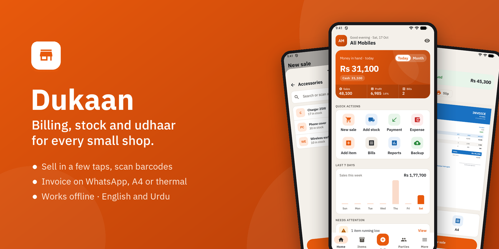
</p>

<h1 align="center">
  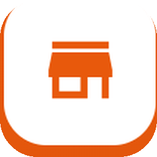&nbsp;Dukaan
</h1>

<p align="center">
  <b>Offline billing, stock and udhaar (customer credit) for any small shop.</b><br>
  Sell in a few taps, hand the customer a proper invoice, and know today's cash and profit at a glance.
</p>

<p align="center">
  
  
  
  
  
  
</p>

<p align="center">
  <a href="#features">Features</a> ·
  <a href="#screenshots">Screenshots</a> ·
  <a href="#how-a-sale-works">How a sale works</a> ·
  <a href="#getting-started">Getting started</a> ·
  <a href="#using-the-app">Using the app</a> ·
  <a href="#documentation">Documentation</a>
</p>

---

> **Dukaan** (دکان, "shop") is a working name. The first client is a mobile-phone shop in Lahore,
> and the app is built to work just as well for a grocery, clothing, pharmacy or hardware shop.

## Features

| | |
|---|---|
| 🛒 **Fast selling** | Tap **Sell**, pick a category, tap items to fill the cart. Search by name or **scan a barcode** to add an item instantly. Discounts, optional tax, Cash / Bank / JazzCash-Easypaisa. |
| 🧾 **Real invoices** | A4 invoice templates (**Modern, Classic, Minimal**) and thermal slips (**Classic, Compact, Bold**) with your logo, colour, tax number and terms. Share the PDF on WhatsApp, print A4, or print on a 58/80 mm Bluetooth printer. |
| 📦 **Stock that counts itself** | Every sale, purchase, return and correction updates stock. Items live in **categories**, with low-stock alerts and an optional per-unit **serial / IMEI** for phones and electronics. |
| 💰 **Two prices, true profit** | Each item has a **purchase price** and a **sale price** with live profit per unit. Reports use what each batch really cost (FIFO), so profit stays correct when buying prices change. |
| 🤝 **Udhaar and suppliers** | Customer and supplier balances, record payments, full history per person, and a one-tap WhatsApp reminder. |
| 📊 **Home and reports** | Today's money in hand, sales, profit and margin; a 7-day chart; reports by day or month with items sold, expenses and **CSV export**. |
| 🔐 **Safe by design** | Works fully **offline**. PIN / fingerprint lock, a "hide cost" switch for the counter, backup file export and import, and sales that are never deleted (voids and returns keep the history). |
| 👥 **Accounts and sync** *(optional)* | Owner and staff accounts, live sync between the shop's phones, and a cloud copy, all on Firebase's free plan. Without Firebase the app runs local-only. |
| 🌐 **English and Urdu** | Full Urdu translation with a right-to-left layout, Nastaliq type, and lakh-style amounts (1,77,700). |

## Screenshots

<table>
  <tr>
    <td align="center">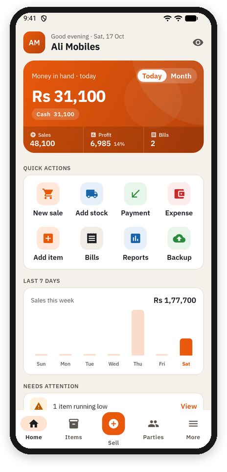<br><b>Home</b><br><sub>Cash in hand, profit, 7-day chart</sub></td>
    <td align="center">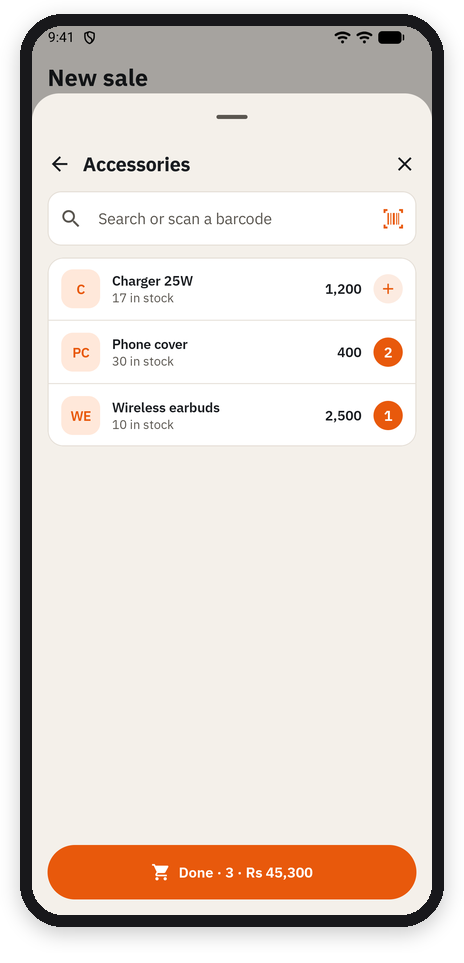<br><b>Sell</b><br><sub>Category → tap items → done</sub></td>
    <td align="center">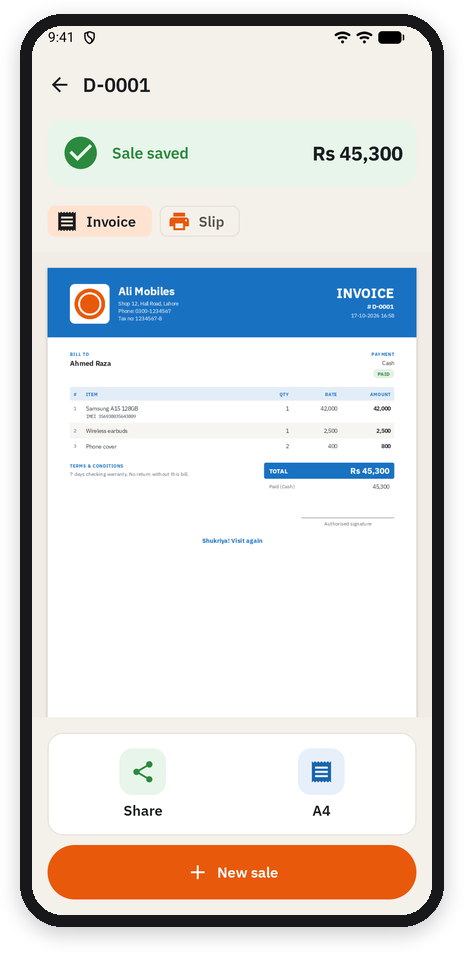<br><b>Invoice</b><br><sub>Share, A4 or thermal slip</sub></td>
  </tr>
  <tr>
    <td align="center">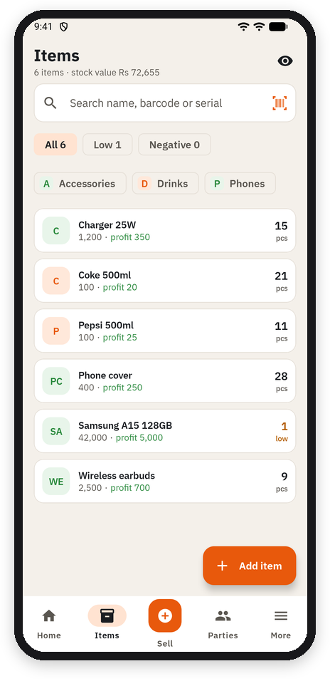<br><b>Items</b><br><sub>Categories, stock and profit per item</sub></td>
    <td align="center">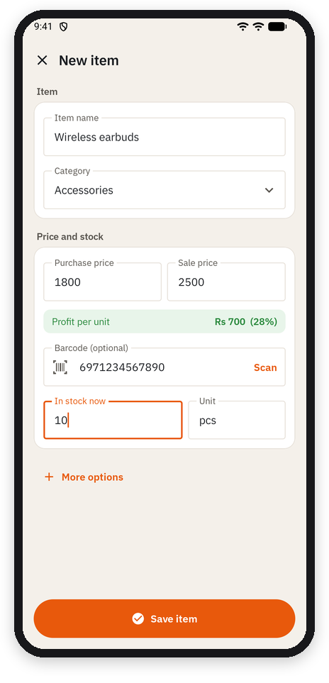<br><b>Add item</b><br><sub>Purchase + sale price, barcode</sub></td>
    <td align="center">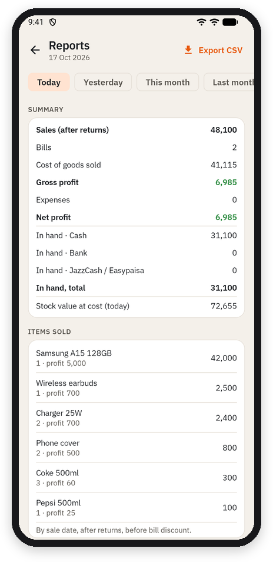<br><b>Reports</b><br><sub>Sales, profit, cash, items sold</sub></td>
  </tr>
</table>

<details>
<summary><b>More screens</b> (sign-in, stock, parties, settings, Urdu)</summary>
<br>

**Getting in**

<table>
  <tr>
    <td align="center">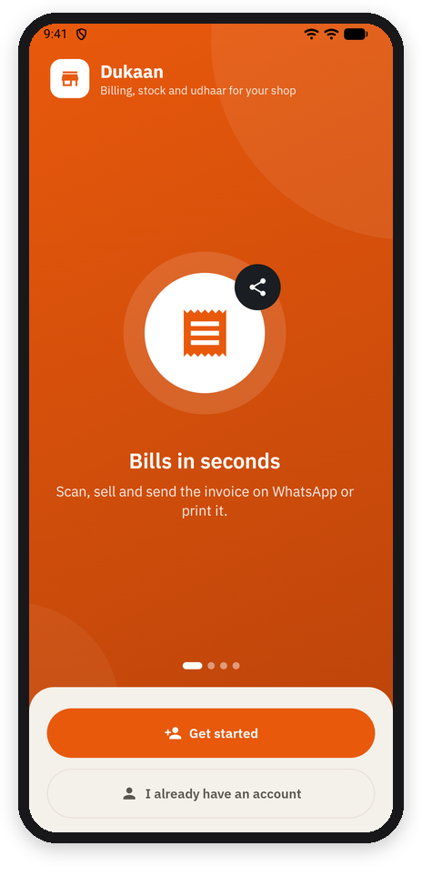<br><sub>Landing</sub></td>
    <td align="center">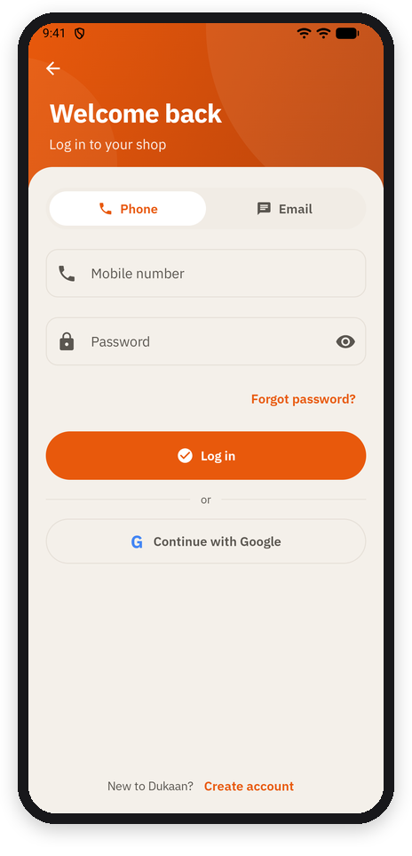<br><sub>Log in</sub></td>
    <td align="center">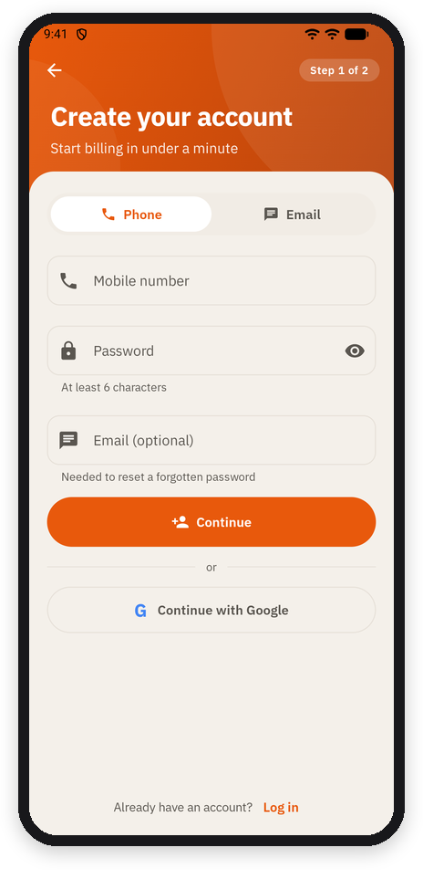<br><sub>Create account</sub></td>
  </tr>
</table>

**Selling**

<table>
  <tr>
    <td align="center">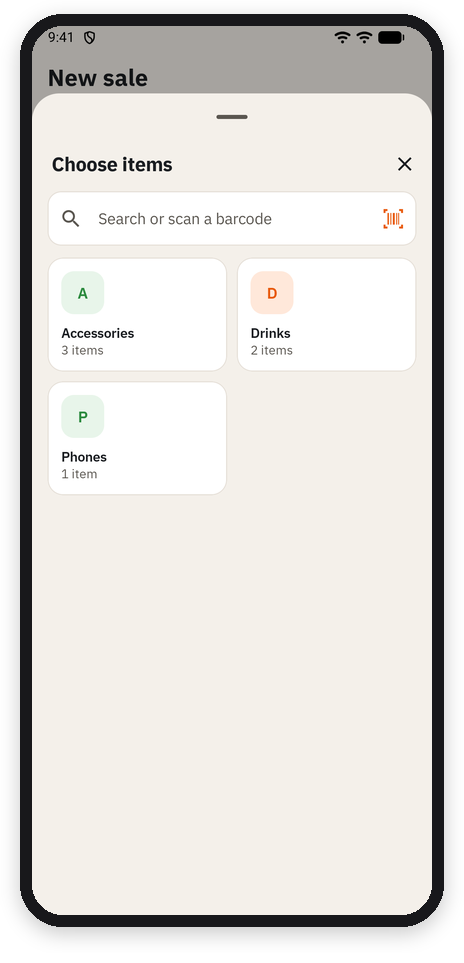<br><sub>Choose a category</sub></td>
    <td align="center">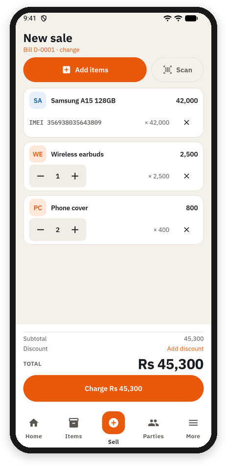<br><sub>Cart with IMEI line</sub></td>
    <td align="center">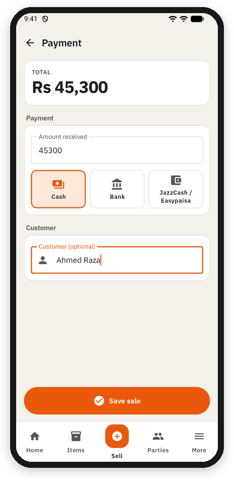<br><sub>Payment and customer</sub></td>
    <td align="center">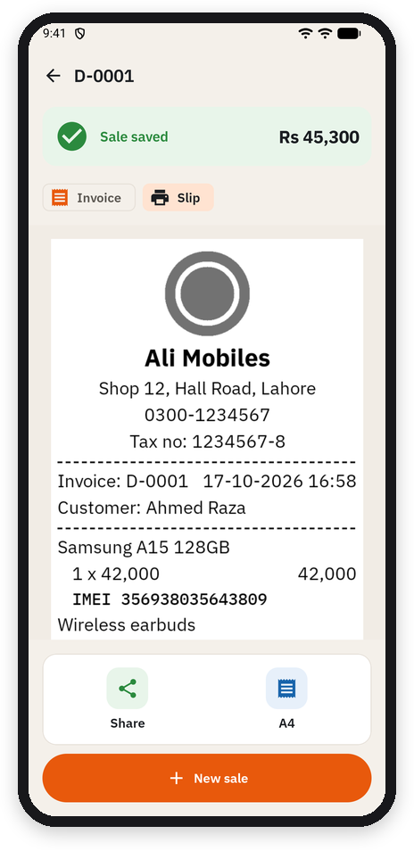<br><sub>Thermal slip</sub></td>
  </tr>
</table>

**Stock**

<table>
  <tr>
    <td align="center">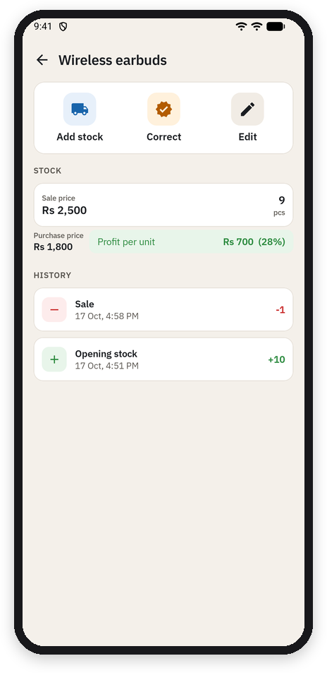<br><sub>Item: prices, profit, history</sub></td>
    <td align="center">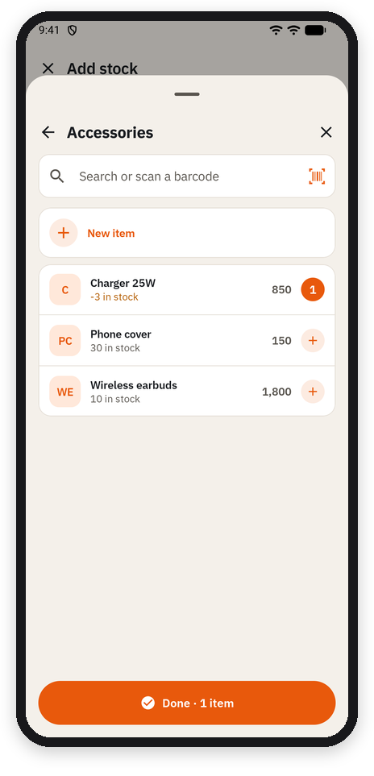<br><sub>Add stock: pick items</sub></td>
    <td align="center">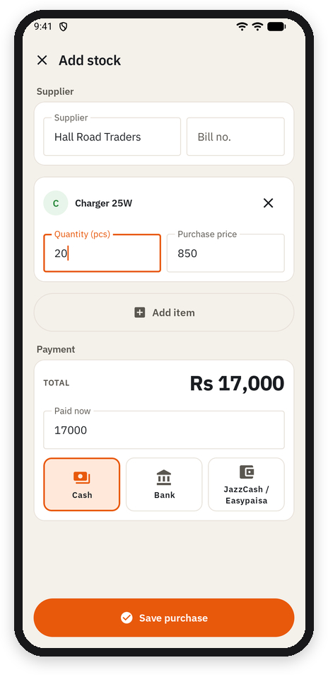<br><sub>Supplier, quantity, cost</sub></td>
  </tr>
</table>

**Money and settings**

<table>
  <tr>
    <td align="center">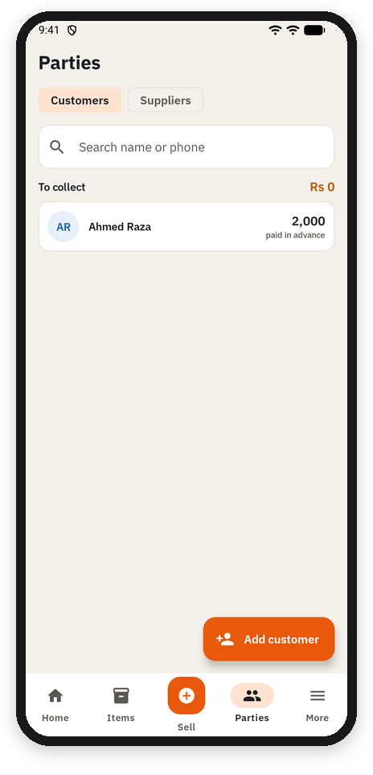<br><sub>Customers and suppliers</sub></td>
    <td align="center">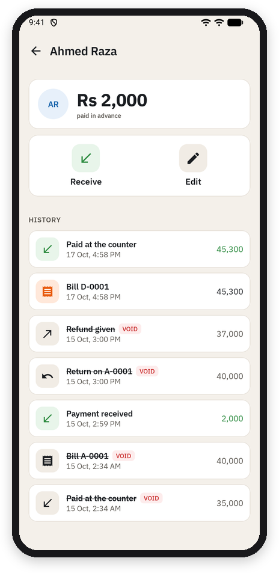<br><sub>Customer history</sub></td>
    <td align="center">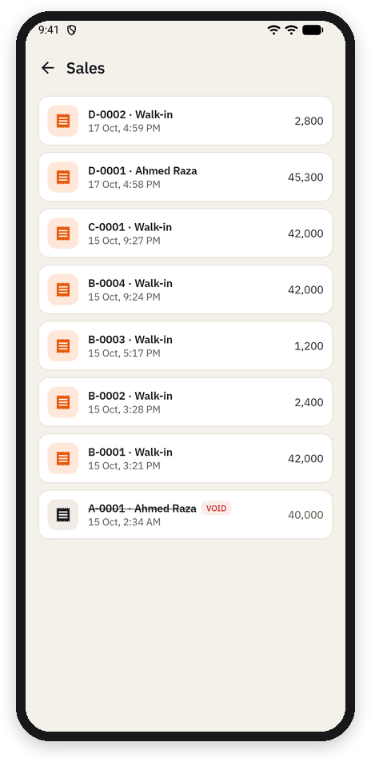<br><sub>All bills</sub></td>
  </tr>
  <tr>
    <td align="center">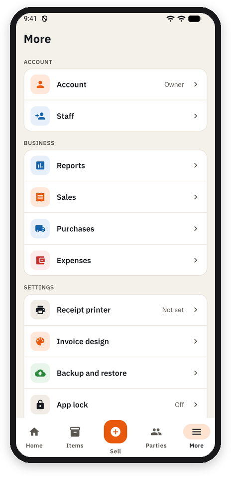<br><sub>More: reports, settings</sub></td>
    <td align="center">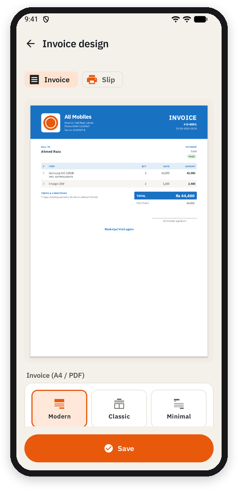<br><sub>Invoice design</sub></td>
    <td align="center">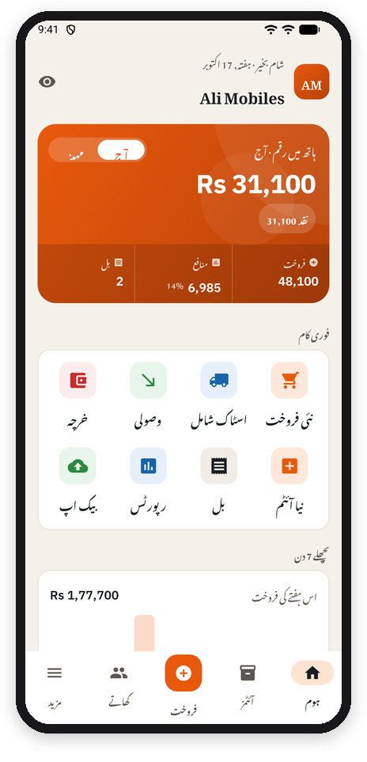<br><sub>Home in Urdu (right to left)</sub></td>
  </tr>
</table>

</details>

## How a sale works

<p align="center">
  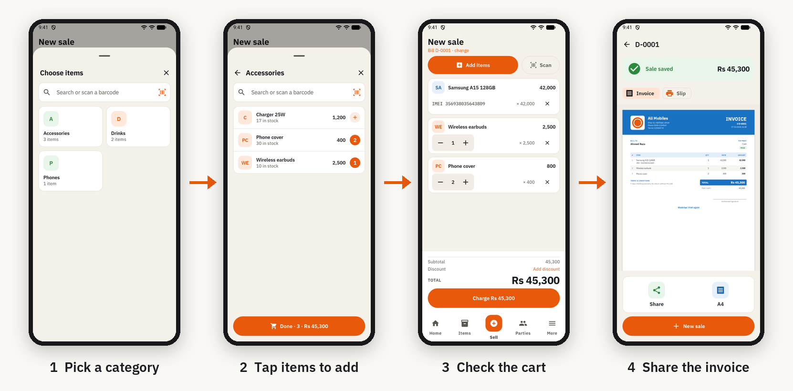
</p>

1. Tap **Sell**. A sheet opens with your categories.
2. Open a category and tap items; each tap adds one to the cart (the orange badge shows how many). Scanning a barcode adds the item straight away.
3. Tap **Done**, check quantities, add a discount if needed, then **Charge**.
4. Enter what the customer paid (anything less becomes udhaar on their account) and **Save sale**.
5. Share the invoice on WhatsApp, print A4, or switch to **Slip** for the thermal printer.

## Getting started

### Install on a phone

Dukaan is not on the Play Store yet. To try it, build the debug APK (below) and install it with
`./gradlew installDebug`, or copy `app/build/outputs/apk/debug/app-debug.apk` to an Android 8.0+
phone and open it.

On first launch, tap **Get started**, create an account and enter your shop's name and type (a build
without Firebase skips the account and goes straight to the shop details). Then add your first item
and make a sale.

### Build from source

**You need:** Android Studio (or the Android SDK with compileSdk 37) and JDK 17 or newer.

```bash
git clone <this repo> dukaan && cd dukaan

./gradlew assembleDebug        # build the debug APK
./gradlew installDebug         # install on a connected phone or emulator
./gradlew testDebugUnitTest    # run the JVM tests (no emulator needed)
./gradlew lintDebug            # lint; hard-coded text and left/right layout are errors
```

Add `--offline` when the Gradle cache is already warm. A change is ready when
`testDebugUnitTest lintDebug assembleDebug` are all green.

### Optional: accounts, sync and crash reports

Accounts, staff, live sync and Crashlytics switch on only when a Firebase config is present:

1. Create a Firebase project (the free Spark plan is enough) and add an Android app with the
   package `app.dukaan.android`.
2. Enable **Authentication** (Email/Password and Google) and **Cloud Firestore**.
3. Download `google-services.json` into `app/` (it is gitignored).
4. Paste [`firestore.rules`](firestore.rules) into Firestore → Rules and publish.

Without the file the app builds and runs fully offline as a single-phone shop. Details are in
[docs/ACCOUNTS.md](docs/ACCOUNTS.md) and [docs/SYNC.md](docs/SYNC.md).

## Using the app

| I want to… | Where |
|---|---|
| Make a sale | **Sell** button (centre of the bottom bar) |
| Add a new product | **Items → Add item**: name, category, purchase and sale price, barcode, opening stock |
| Record stock I bought | Home → **Add stock**: pick items, supplier, quantity and cost |
| Track phones by IMEI | Add item → **More options** → *Track each unit by serial / IMEI* |
| Take money from a customer who owes | **Parties** → the customer → **Receive** |
| Void a bill or take a return | **More → Sales** → open the bill |
| Record rent, salary, bills | Home → **Expense** |
| See profit for a day or month | Home → **Reports**; **Export CSV** for a spreadsheet |
| Change the invoice look | **More → Invoice design** |
| Connect a thermal printer | **More → Receipt printer** (pair it in Android Bluetooth settings first) |
| Hide costs from customers at the counter | The 👁 eye button on Home or Items |
| Switch to Urdu | **More → Language** |
| Keep a backup | **More → Backup and restore** → export a file (save it to Drive or WhatsApp) |

## Under the hood

| | |
|---|---|
| **Language and UI** | Kotlin 2.4, Jetpack Compose (Material 3), Navigation-Compose |
| **Data** | Room 3 on bundled SQLite; money as `Long` paisa, quantities as `Long` milli-units |
| **Ledger** | Every stock change goes through one `LedgerService` transaction; stock, FIFO batch costs and IMEI status are rebuilt from facts, so phones that sync always agree |
| **Hardware** | CameraX + ML Kit barcode scanning (on-device, offline), ESC/POS raster printing over Bluetooth, Android print for A4 |
| **Accounts** | Firebase Auth + Firestore (optional), app lock with BiometricPrompt |
| **Build** | AGP 9.4, Gradle 9.6, KSP; compileSdk 37, targetSdk 36, minSdk 26; CI in `.github/workflows/ci.yml` |

```
app/src/main/java/app/dukaan/android/
├── core/        db · ledger · money · receipt · printer · scan · backup · lock · account · sync · ui
└── feature/     auth · onboarding · home · sell · items · purchase · parties · expenses · reports · more
```

## Documentation

| Doc | What's in it |
|-----|--------------|
| [CLAUDE.md](CLAUDE.md) | Rules and commands for anyone (human or agent) changing the code |
| [docs/PRD.md](docs/PRD.md) | What we're building and for whom; user stories |
| [docs/ARCHITECTURE.md](docs/ARCHITECTURE.md) | Data model, transactions, FIFO, invariants |
| [docs/DESIGN.md](docs/DESIGN.md) | Design system, screens, flows, receipt layout |
| [docs/PLAN.md](docs/PLAN.md) | Milestones with checklists |
| [docs/PROGRESS.md](docs/PROGRESS.md) | Current status |
| [CHANGELOG.md](CHANGELOG.md) | What changed, per version |
| [docs/DECISIONS.md](docs/DECISIONS.md) | Every product and tech decision, and why |
| [docs/TESTING.md](docs/TESTING.md) | Test strategy and required cases |
| [docs/RELEASE.md](docs/RELEASE.md) | Signing, Play Store, Crashlytics, Data safety, listing, migrations |
| [docs/PRIVACY.md](docs/PRIVACY.md) | Privacy policy draft |
| [docs/ACCOUNTS.md](docs/ACCOUNTS.md) | Accounts, staff, cloud copy: design, limits, Firestore layout |
| [docs/SYNC.md](docs/SYNC.md) | Live sync between a shop's phones: merging, clashes, cost |
| [docs/FUTURE_FEATURES.md](docs/FUTURE_FEATURES.md) | Backlog of deferred features |

<sub>Screenshots are from the debug build on an Android 16 emulator with sample data from a demo
mobile shop. Fonts: IBM Plex Sans and Noto Nastaliq Urdu (SIL Open Font License).</sub>
